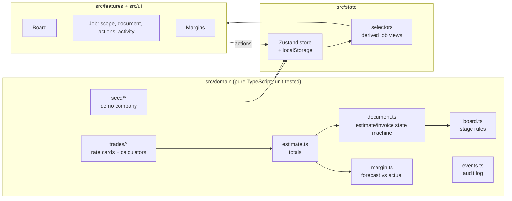

# Trueline

Job management for **Plumbline Renovation Co.**, a fictional home-improvement contractor. Build an estimate room by room, turn it into an invoice, take payments, track change orders, and see whether each job is hitting its margin.

It's a portfolio demo. There's no backend: everything runs in the browser and is saved to localStorage. **Reset demo** in the header restores the sample company.

> [Screenshot: job board]
> [Screenshot: estimate → invoice → receipt]
> [Screenshot: margin dashboard]

## What it does

- **Estimate builder.** Interior painting, flooring and tile backsplash, priced room by room. Line items are grouped by materials, labor and other, with collapsible sections.
- **Estimate → invoice → receipt.** Send, sign (you play the client), convert, record payments, and download a PDF receipt. An invoice can be reverted to an estimate until money is received.
- **Adjustments.** Change orders appear to the client as "Adjustments". A job can't change stage while one is waiting for approval.
- **Activity log.** One event log with two views: the full internal log and what the client sees.
- **Job board.** Drag-and-drop Kanban (pointer and keyboard). Moves that break a rule spring back with the reason.
- **Margins.** Forecast vs. actual by job and by cost category, per-trade targets with effective dates, and a PM / Accounting toggle that hides or shows commission.

All rates, formulas, rules, names and data are invented for this demo.

## Stack

Next.js 15 (App Router) · TypeScript (strict) · Tailwind CSS 4 · Zustand · Framer Motion · dnd-kit · Recharts · @react-pdf/renderer · Vitest · Playwright

## Architecture



- **Domain first.** Every business rule is a pure function with no React or browser APIs. Rule checks return `{ ok: true, value }` or `{ ok: false, reason }`, and the UI shows `reason` as written.
- **Money is integer cents.** Cost and markup are kept separate on every line, so margin can always be computed.
- **Derive, don't store.** Totals, balance, paid-in-full, the Estimate/Invoice/Receipt label and margins are all calculated from stored facts.
- **The store is thin.** Actions call domain functions, write the result, and append an event.

## Design

The look comes from carbon-copy job forms: **white copy for the estimate, canary for the invoice, pink for the receipt.** Converting tears the top sheet off to reveal the next copy, and paying in full lands a PAID stamp. The app shell stays a quiet graphite so the paper reads as the focus. Type: Archivo (expanded), Public Sans, Courier Prime.

## Run it

```bash
npm install
npm run dev        # http://localhost:3000
npm test           # unit tests (Vitest)
npm run build
npx playwright install chromium   # first time only
npm run e2e        # smoke tests against a production build on :3100
```

## Deploy

Push to GitHub and import the repo in Vercel. It needs no environment variables.

## Project layout

```
src/
  app/          routes: /, /board, /jobs/[jobId], /margins
  domain/       pure business logic + tests
  state/        Zustand store and selectors
  features/     board, estimate, documents, margin, shell
  ui/           Button, Dialog, Segmented, toast
docs/           feature map and design proposal
e2e/            Playwright smoke tests
```
